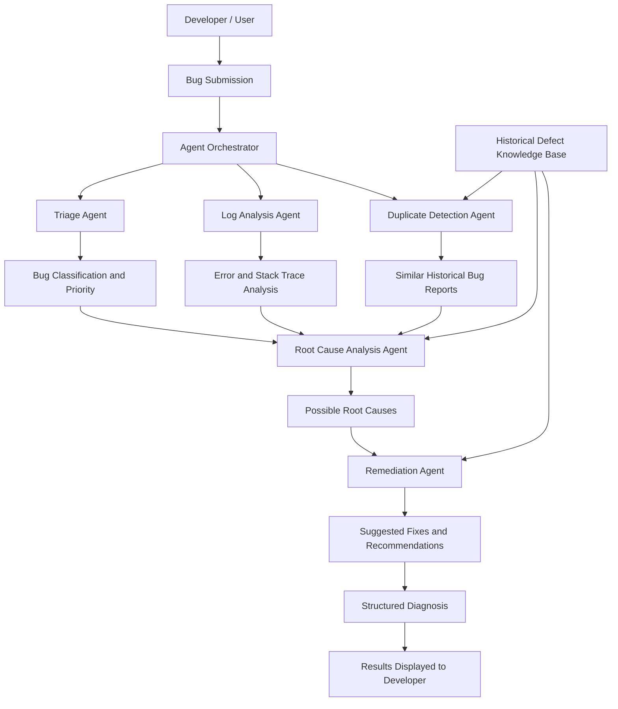

# M1.2 – System Architecture Design

## Project Name
Creation of Intelligent Bug Diagnosis Platform with Fix Recommendation Assistance

## 1. Introduction

The Intelligent Bug Diagnosis Platform is designed to analyze software bug reports, retrieve similar historical defects, identify possible root causes, and provide fix recommendations.

The proposed architecture combines frontend development, backend APIs, database storage, Retrieval-Augmented Generation (RAG), vector search, Large Language Models (LLMs), and specialized AI agents.

The system follows a modular architecture in which each component performs a specific responsibility.

## 2. High-Level System Architecture

The system consists of the following major components:

1. Bug Submission / User Interface
2. Backend / API Layer
3. Bug Report Upload and Storage
4. Bug Report Processing Module
5. Bug Report Database
6. Historical Defect Knowledge Base
7. Data Cleaning and Chunking Pipeline
8. Embedding Generation Module
9. Vector Database / Semantic Search
10. RAG Retrieval Pipeline
11. Large Language Model (LLM)
12. AI Agent Layer
13. Agent Orchestrator
14. Structured Findings / Diagnosis Module
15. Results and Recommendations Interface
16. Knowledge Base Update Module

## 3. System Components and Responsibilities

### 3.1 Bug Submission Interface

Provides an interface for developers to submit software bug reports.

Main functionalities:
- Enter bug title and description.
- Paste stack traces.
- Paste error logs.
- Upload bug report files.
- Submit bug information.

### 3.2 Backend / API Layer

The backend manages communication between the frontend and internal system components.

Responsibilities:
- Receive bug submissions.
- Validate input information.
- Handle file uploads.
- Communicate with database services.
- Trigger bug processing workflows.

### 3.3 Bug Report Processing Module

Processes the submitted bug information.

Responsibilities:
- Extract text from supported files.
- Clean and normalize text.
- Identify important error information.
- Prepare bug reports for analysis.

### 3.4 Bug Report Database

Stores submitted bug report information.

Proposed database: MongoDB.

Information includes:
- Bug ID
- Title
- Description
- Stack trace
- Error logs
- Submission date
- Processing status

### 3.5 Historical Defect Knowledge Base

Contains previously reported software defects collected from public sources such as Mozilla, Apache, and Eclipse.

It provides historical information for identifying similar bugs and finding possible solutions.

### 3.6 Data Cleaning and Chunking Pipeline

Prepares historical defect reports for retrieval.

Responsibilities:
- Remove duplicate records.
- Handle missing information.
- Standardize bug report formats.
- Divide large documents into meaningful chunks.
- Preserve relevant metadata.

### 3.7 Embedding Generation Module

Converts text chunks into numerical vector representations using an embedding model.

Proposed model: Sentence Transformers.

These embeddings capture semantic information and support similarity-based retrieval.

### 3.8 Vector Database / Semantic Search

Proposed vector database: ChromaDB.

Responsibilities:
- Store generated embeddings.
- Maintain associated metadata.
- Search for similar historical defects.
- Retrieve relevant bug report chunks.

### 3.9 RAG Retrieval Pipeline

The RAG pipeline connects the submitted bug report with historical defect information.

Workflow:
1. Receive the processed bug report.
2. Generate its embedding.
3. Search the vector database.
4. Retrieve relevant historical bug reports.
5. Prepare retrieved information as context for the LLM.

### 3.10 Large Language Model

The LLM uses the submitted bug details and retrieved historical information to generate contextual analysis.

Proposed service: Gemini API.

Responsibilities:
- Explain possible errors.
- Analyze retrieved defect information.
- Assist with root cause identification.
- Generate potential fix recommendations.

### 3.11 AI Agent Layer

The AI Agent Layer consists of five specialized agents.

- Triage Agent
- Log Analysis Agent
- Root Cause Agent
- Duplicate Detection Agent
- Remediation Agent

Their responsibilities are defined separately in the agent design document.

### 3.12 Agent Orchestrator

The orchestrator coordinates the execution of specialized agents.

Responsibilities:
- Manage the analysis workflow.
- Pass relevant information between agents.
- Coordinate agent execution.
- Collect agent outputs.
- Send findings for final result generation.

Proposed framework: LangGraph.

### 3.13 Structured Findings and Diagnosis Module

Combines the outputs of the agents into a structured diagnosis.

Expected information:
- Bug category
- Severity
- Log analysis
- Similar historical defects
- Possible root cause
- Suggested fix
- Supporting evidence

### 3.14 Results and Recommendations Interface

Displays the generated analysis to the developer.

The interface presents:
- Bug summary
- Classification and severity
- Similar historical bug reports
- Root cause explanation
- Recommended solutions

### 3.15 Knowledge Base Update Module

Provides a mechanism to update the historical defect knowledge base with eligible new defect information and validated resolutions.

Any addition should be checked and standardized before indexing.

## 4. Agent Responsibilities

| Agent | Main Responsibility |
|---|---|
| Triage Agent | Classifies bug type and severity |
| Log Analysis Agent | Examines error logs and stack traces |
| Root Cause Agent | Identifies possible causes |
| Duplicate Detection Agent | Finds similar historical bugs |
| Remediation Agent | Suggests potential fixes |

## 5. Agent Orchestration Flow

The proposed agent workflow is:

1. User submits a bug report.
2. Backend validates and processes the report.
3. Triage Agent classifies the bug.
4. Log Analysis Agent examines the stack trace and error logs.
5. Duplicate Detection Agent identifies similar historical defects using retrieved information.
6. Root Cause Agent analyzes the available evidence.
7. Remediation Agent generates potential solutions.
8. Agent Orchestrator collects the results.
9. Structured diagnosis is generated.
10. Results are displayed to the user.

## 6. Proposed Bug Report Data Model

| Field | Data Type | Description |
|---|---|---|
| bug_id | String | Unique bug identifier |
| title | String | Bug title |
| description | String | Bug description |
| stack_trace | String | Error stack trace |
| error_log | String | Error log details |
| severity | String | Bug severity |
| status | String | Submission status |
| created_at | DateTime | Submission timestamp |

## 7. Proposed Historical Defect Data Model

| Field | Data Type | Description |
|---|---|---|
| defect_id | String | Historical defect identifier |
| project | String | Mozilla, Apache, or Eclipse |
| title | String | Defect title |
| description | String | Defect description |
| comments | String | Discussion details |
| resolution | String | Available resolution |
| chunk_id | String | Chunk identifier |
| embedding | Vector | Numerical representation |
| metadata | Object | Additional defect information |

## 8. End-to-End Data Flow

The overall data flow is divided into two major pipelines.

### A. Bug Submission Pipeline

Developer → Bug Submission Interface → Backend API → Input Validation → Bug Processing → Bug Database → Bug Analysis.

### B. Historical Knowledge Base Pipeline

Public Bug Datasets → Data Cleaning → Text Chunking → Embedding Generation → ChromaDB Indexing → Semantic Retrieval → RAG Pipeline → LLM.

Both pipelines connect during bug diagnosis, where the submitted bug is compared with historical defects.

## 9. Proposed Architecture Technologies

| Component | Technology |
|---|---|
| User Interface | React.js |
| Backend API | FastAPI |
| Bug Report Storage | MongoDB |
| Data Processing | Python, Pandas |
| Embedding Generation | Sentence Transformers |
| Vector Database | ChromaDB |
| Retrieval Pipeline | LangChain |
| Language Model | Gemini API |
| Agent Orchestration | LangGraph |

## 10. Conclusion

The proposed system architecture provides a modular foundation for the Intelligent Bug Diagnosis Platform.

It connects bug submission, defect processing, historical knowledge retrieval, semantic search, RAG, and AI agents into a unified workflow.

This architecture will guide the development of the bug submission module and historical defect knowledge base during Milestone 1.

---

**Milestone:** M1.2 – System Architecture  
**Project:** Intelligent Bug Diagnosis Platform with Fix Recommendation Assistance  
**Internship:** Infosys Springboard Virtual Internship

## 7. AI Agent Architecture Diagram

